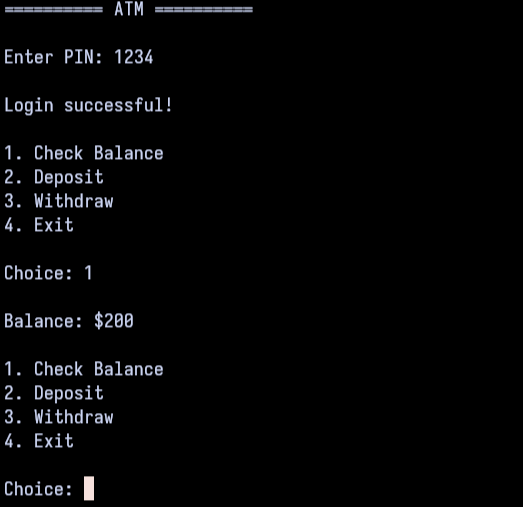

# ATM Simulator

A simple ATM simulator to replicate real-life ATM machine functionality

Disclaimer, this is suppose to be an ATM simulation application but do not take this for grant it. This program and repository are meant to be use for self-learning and github development

`v1.1`

## Preview


## Dependencies
- gcc

## Build

Paste these commands into your terminal and run them:

```
git clone https://github.com/adxql/atm-sim
cd atm-sim
```

Once you are in the `./atm-sim`, you now need to paste and run:

```
g++ main.cpp -o atm-sim
```

Now, you can run the application but running:

```
./atm-sim
```
